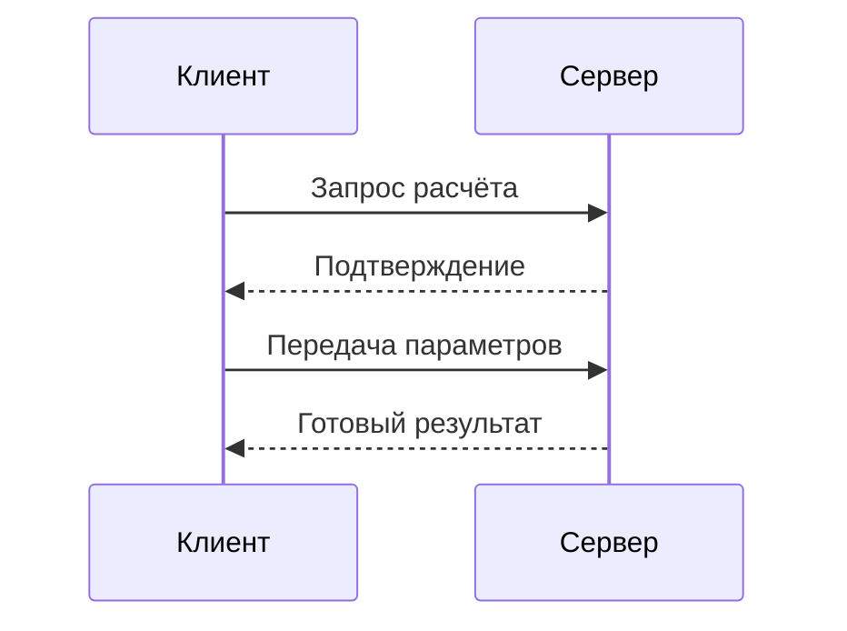
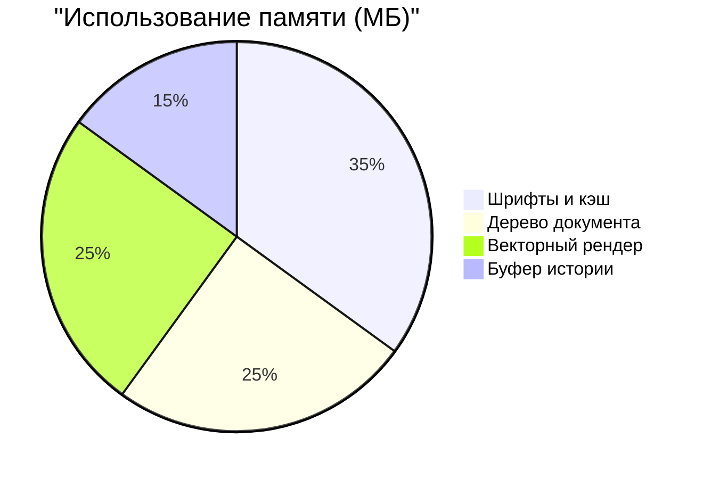

# Научная заметка: Алгоритмы и структуры данных

Численные методы и **анализ сложности** позволяют оценить поведение системы при высоких нагрузках. Вместо громоздких формул в коде мы используем *наглядные визуальные модели* и компактные структуры данных.

## Фундаментальные соотношения

Сумма ряда и определённый интеграл наглядно демонстрируют переход от дискретной модели к непрерывной:

```latex
\int_{a}^{b} f(x)\,dx = \sum_{i=1}^{n} x_i
```

Матрица переходов состояния системы для двух независимых узлов:

```latex
\begin{bmatrix}
\alpha & \beta \\
\gamma & \delta
\end{bmatrix}
```

## Протокол обмена клиент-сервер



## Распределение ресурсов памяти



## Пример реализации на C++17

```cpp
#include <vector>
#include <numeric>

double compute_mean(const std::vector<double>& values) {
    if (values.empty()) return 0.0;
    const double sum = std::accumulate(values.begin(), values.end(), 0.0);
    return sum / static_cast<double>(values.size());
}
```
