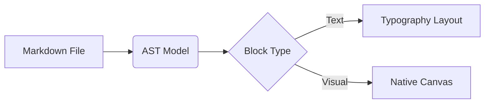
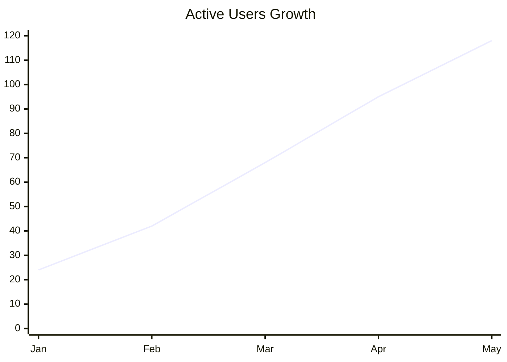

# Product Overview & Engineering Notes

**Marked-text-down** is a lightweight *native WYSIWYG Markdown editor* built with `C++17` and `SDL3`. Write naturally, edit formulas and diagrams visually, and keep your files in clean, portable `.md` format.

> Simplicity is about subtracting the obvious and adding the meaningful.

## Benchmark Comparison

| Metric | Electron App | Marked-text-down | Improvement |
| :--- | :---: | :---: | ---: |
| Cold Startup | 1200 ms | 18 ms | 66x faster |
| Idle Memory | 380 MB | 14 MB | 27x lighter |
| Binary Size | 160 MB | 1.2 MB | 130x smaller |

## Architecture Pipeline



## Monthly Active Users Trend



## Core Formula

```latex
\sigma = \sqrt{\frac{\sum_{i=1}^{n} (x_i - \mu)^2}{n}}
```

---

1. Switch between **Dark** and **Light** themes at any time
2. Click any formula, diagram, or chart to open its **visual builder**
3. Export directly to `DOCX`, `PDF`, `HTML`, `ODT`, and `EPUB`
