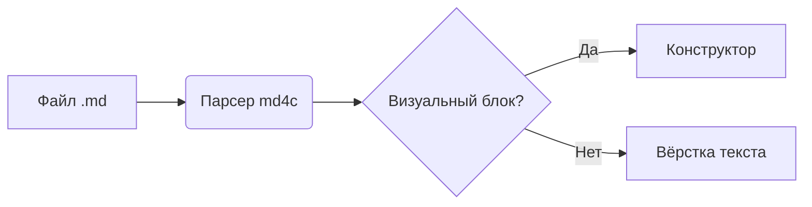
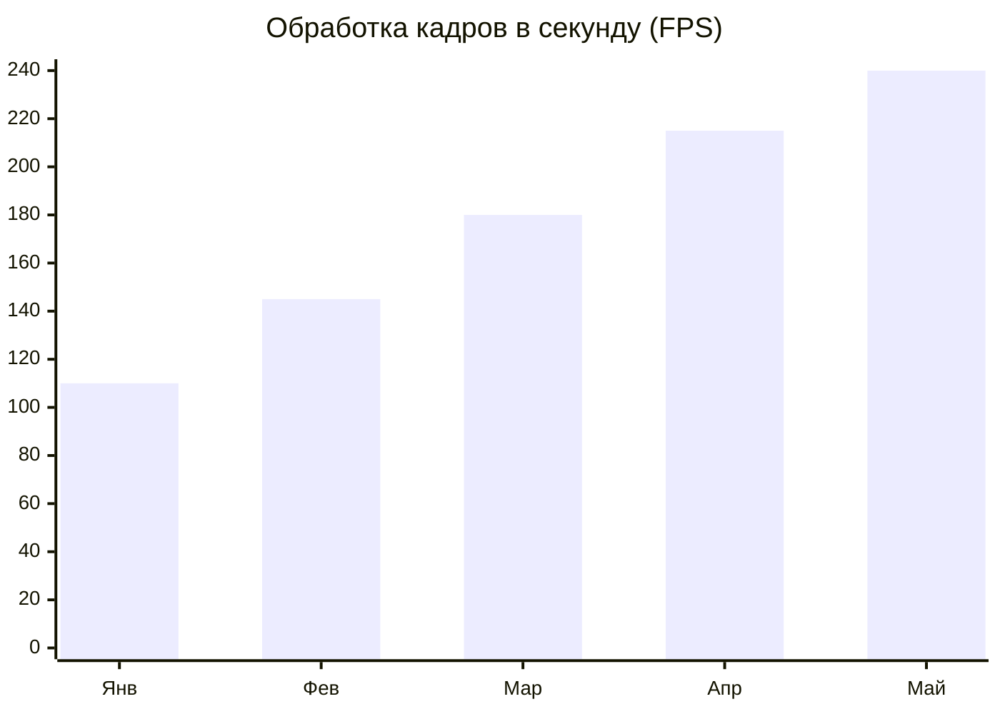

# Архитектура и аналитика релиза v1.0

В новой версии **Marked-text-down** мы объединили *живую типографику*, ~~ручной ввод разметки~~ и **визуальные конструкторы** в одном лёгком нативном приложении. Все изменения сразу сохраняются в чистый `.md`-файл.

> Истинная простота — это когда сложные инструменты ощущаются естественными и незаметными.

## 1. Сводная таблица показателей

| Направление | Q1 (План) | Q2 (Факт) | Статус |
| :--- | :---: | :---: | ---: |
| Скорость запуска | 45 мс | 18 мс | Выполнено |
| Потребление ОЗУ | 32 МБ | 14 МБ | Отлично |
| Экспорт Pandoc | 3 формата | 5 форматов | Готово |

## 2. Схема обработки документа



## 3. Динамика роста производительности



## 4. Математическая модель расчёта

Для оценки сглаживания кривых и распределения весов применяется стандартная квадратичная функция:

```latex
x = \frac{-b \pm \sqrt{b^2 - 4ac}}{2a}
```

---

### Основные преимущества подхода:

- Нативный рендеринг на `SDL3` и `SDL3_ttf` без браузерного движка
- Редактирование формул, схем и графиков в **один клик**
- Полная совместимость с `GitHub Flavored Markdown` и экспорт через `Pandoc`
